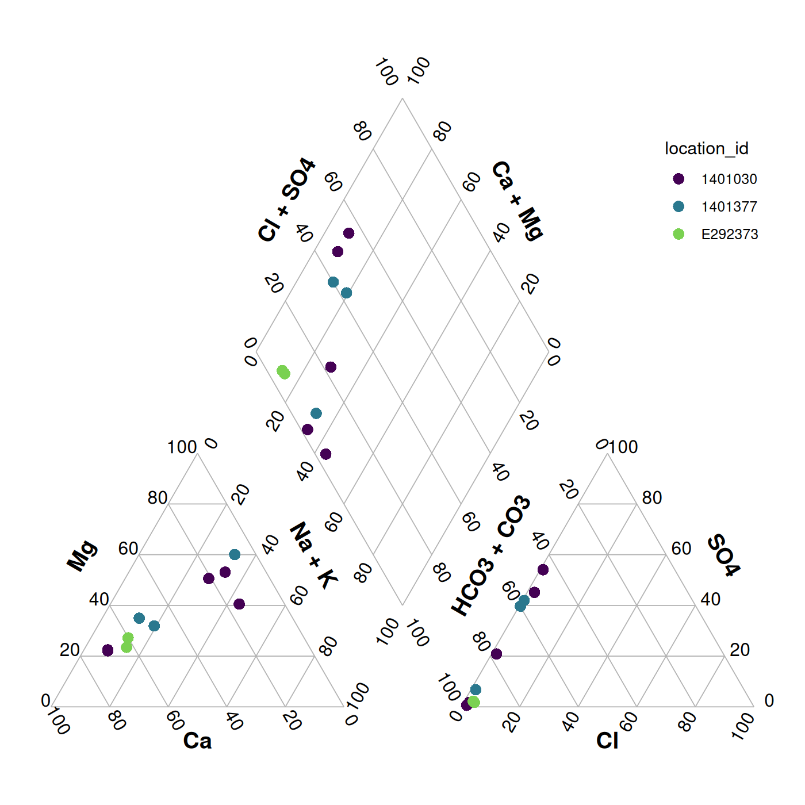
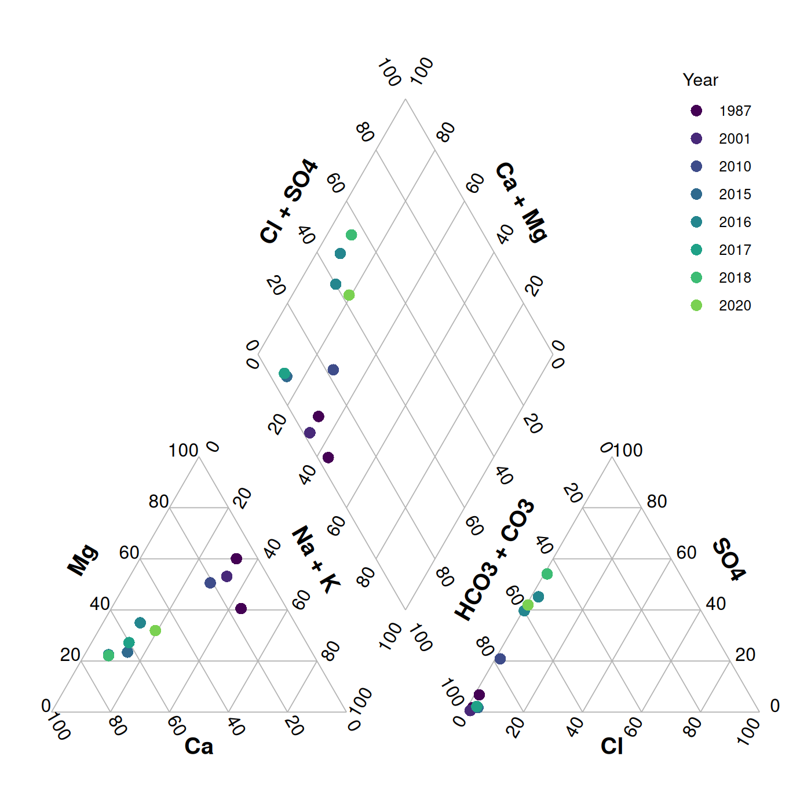
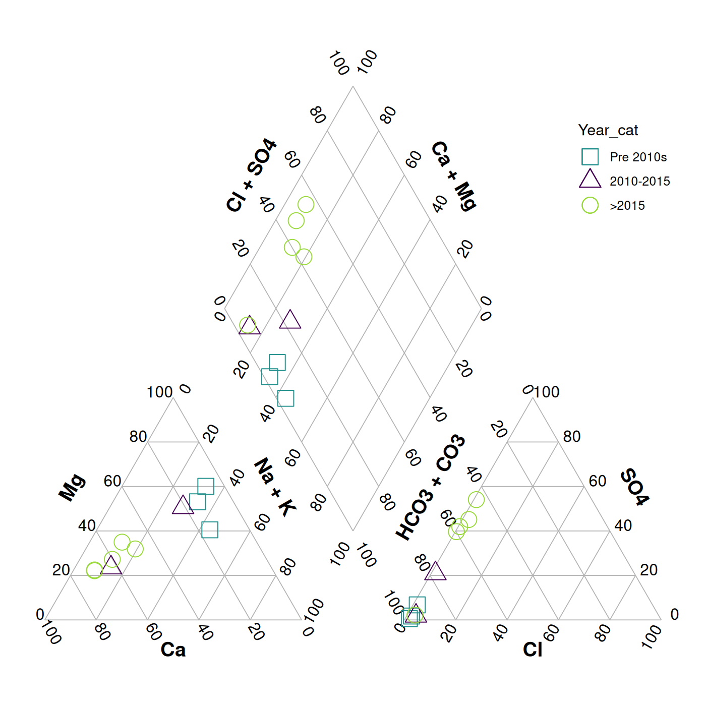
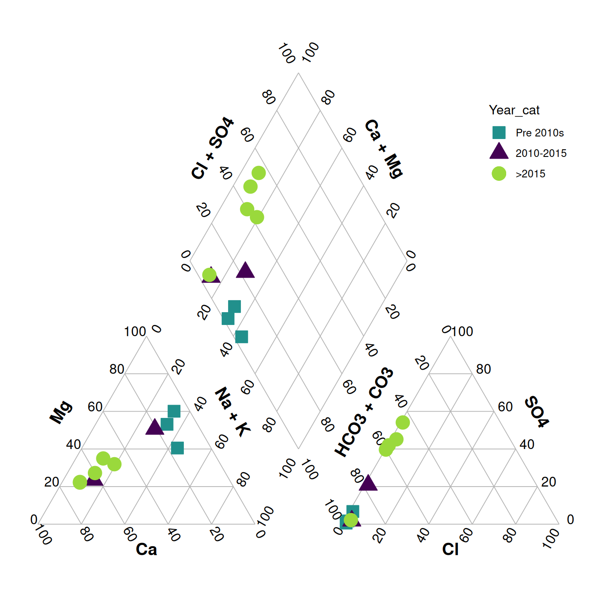
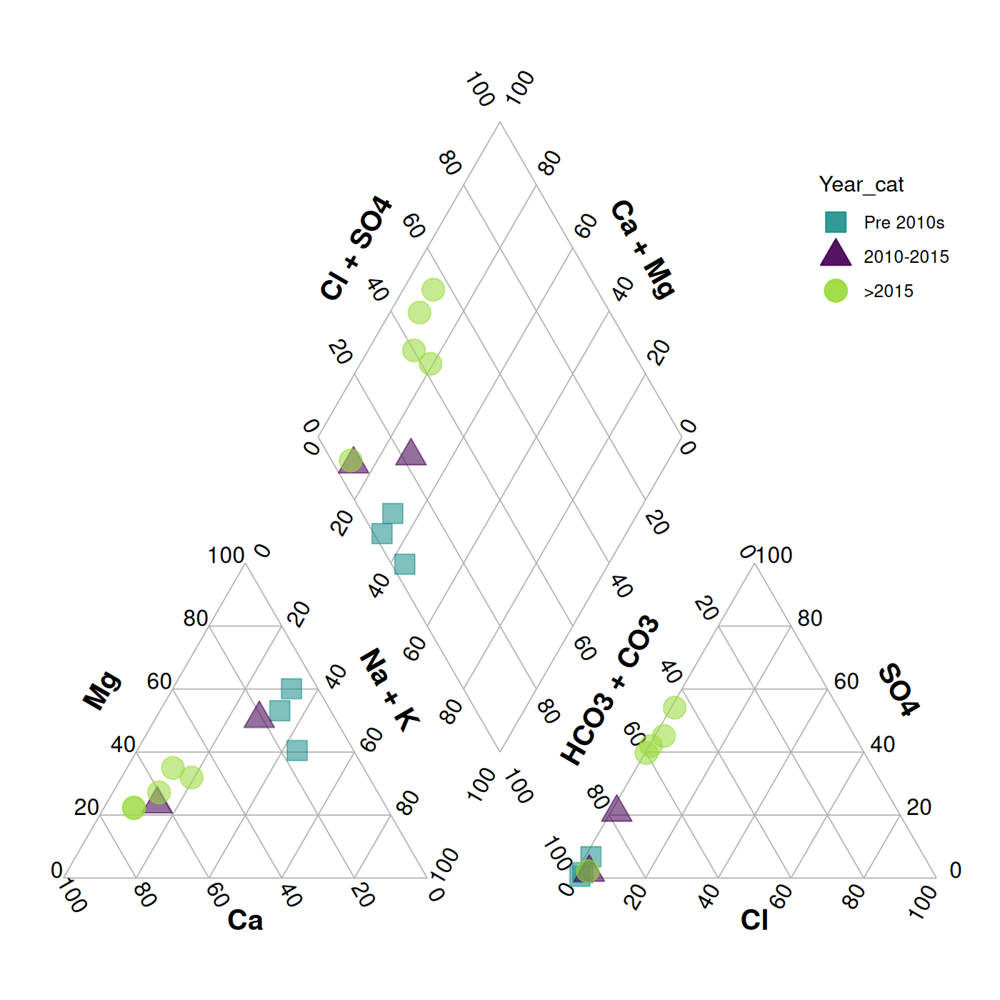
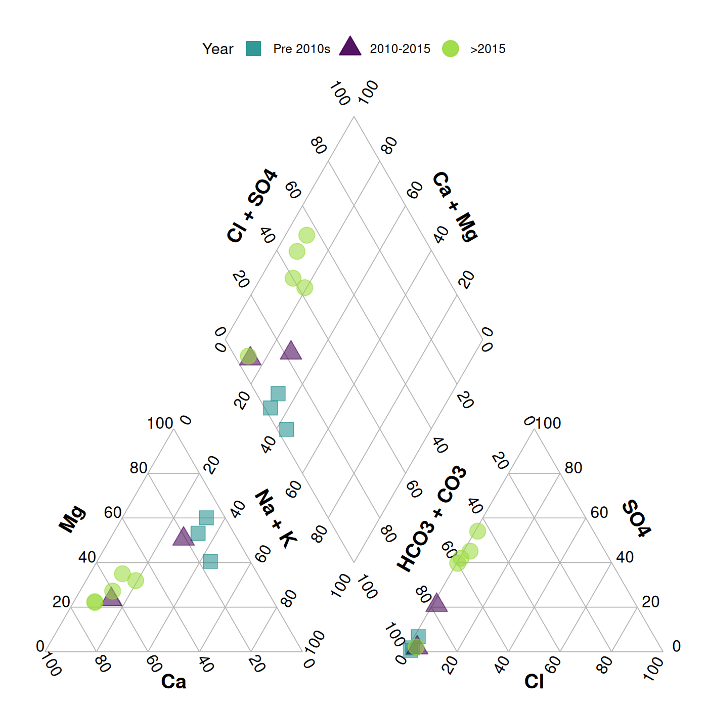
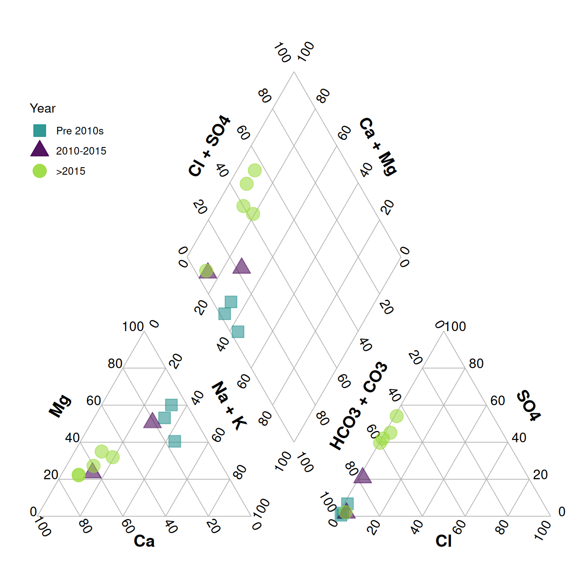
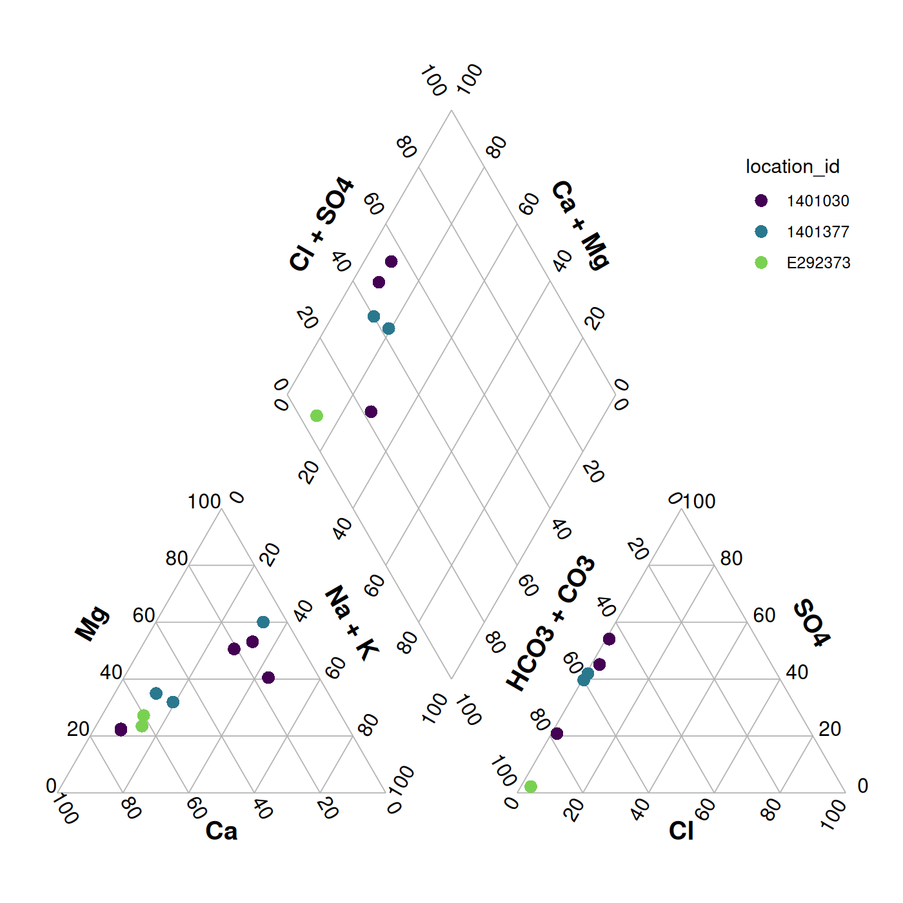

# Custom piperplots

With
[`piper_plot()`](https://bcgov.github.io/bcgwcat2/reference/piper_plot.md)
we can create custom piper plots using data from EMS but with the option
to add grouping variables from other data sets.

This vignette will walk you through how to create custom piper plots
using the
[`piper_plot()`](https://bcgov.github.io/bcgwcat2/reference/piper_plot.md)
function in R.

> Note: Currently you can only customize your piper plots in R (not via
> the Shiny app).

Let’s get started!

First we’ll load the packages we want to use

``` r

library(bcgwcat2) # To download EMS data and create piper plots
library(dplyr) # To manipulate our data
library(lubridate) # To manipulate dates
```

Now let’s get our data by loading a couple of stations’ data. These are
from aquifer 259 (1401030 and 1401377) and aquifer 662 (E292373Q)

``` r

s <- fetch_renmods(ems_ids = c("1401030", "1401377", "E292373"))
#> ℹ Connecting to "yr_2_5", "yr_5_10", and "historic" data for dates between 1965-01-03 and 2024-01-01
#> ✔ yr_2_5: Last downloaded 2026-08-10 16:10:03 (within 26 week(s))
#> ✔ yr_5_10: Last downloaded 2026-08-10 16:12:14 (within 26 week(s))
#> ✔ historic: Last downloaded 2026-08-10 16:16:33 (within 26 week(s))
#> duckdb is storing downloaded extensions and secrets under ~/.duckdb:
#> ℹ /home/steffi/.duckdb
#> This persists across sessions and is shared with the DuckDB CLI and other clients.
#> ℹ Run duckdb(shared_home = FALSE) to use a temporary directory instead.
#> ℹ See ?duckdb_storage for details and alternatives.
```

Let’s take a quick look… lots of data!

``` r

s
#> # A tibble: 794 × 70
#>    Ministry_Contact Sampling_Agency Project Project_Name Work_Order_number Location_ID
#>    <chr>            <chr>           <chr>   <chr>        <chr>             <chr>      
#>  1 Twyla Legault    74 - Permittee  <NA>    <NA>         50224985          1401030    
#>  2 Twyla Legault    74 - Permittee  <NA>    <NA>         <NA>              1401377    
#>  3 Twyla Legault    74 - Permittee  <NA>    <NA>         50224985          1401030    
#>  4 Twyla Legault    74 - Permittee  <NA>    <NA>         50249196          1401377    
#>  5 Graeme Henderson 74 - Permittee  <NA>    <NA>         50233207          E292373    
#>  6 Graeme Henderson 74 - Permittee  <NA>    <NA>         50233207          E292373    
#>  7 Twyla Legault    74 - Permittee  <NA>    <NA>         50249196          1401377    
#>  8 Twyla Legault    74 - Permittee  <NA>    <NA>         50224985          1401030    
#>  9 Graeme Henderson 74 - Permittee  <NA>    <NA>         50233207          E292373    
#> 10 Twyla Legault    74 - Permittee  <NA>    <NA>         50249196          1401377    
#> # ℹ 784 more rows
#> # ℹ 64 more variables: Location_Name <chr>, Location_Type <chr>, Location_Latitude <dbl>,
#> #   Location_Longitude <dbl>, Location_Elevation <dbl>, Location_Elevation_Units <chr>,
#> #   Location_Group <chr>, Field_Visit_Start_Time <dttm>, Field_Visit_End_Time <dttm>,
#> #   Field_Visit_Participants <chr>, Field_Comment <chr>, Field_Filtered <lgl>,
#> #   Field_Filtered_Comment <chr>, Field_Preservative <chr>, Field_Device_ID <chr>,
#> #   Field_Device_Type <chr>, Sampling_Context_Tag <chr>, Collection_Method <chr>, Medium <chr>, …
```

## Groups

By default, the piper plot creates a plot with points coloured by EMS
ID.

``` r

piper_plot(samples = s)
#> Formatting raw samples with `fmt_minimal()`...
```



plot of chunk unnamed-chunk-4

We can override this by specifying the `group` argument ourselves. In
this case, let’s create a column `Year` and colour points that.

First we’ll prepare the data by formatting it. If you don’t need to make
any adjustments,
[`piper_plot()`](https://bcgov.github.io/bcgwcat2/reference/piper_plot.md)
will automatically format your data for you, but if you plan to make
chages, format first, then make your changes.

``` r

ss <- fmt_minimal(s)

ss <- mutate(ss, Year = factor(year(observed_date_time)))

piper_plot(ss, group = "Year")
```



plot of chunk unnamed-chunk-5

## Appearance

We can also customize the appearance of the points.

First let’s create some year categories to group by. We’ll also turn
this variable into a factor (category) and specify the order of the
levels so our legend is in the correct order.

``` r

ss <- mutate(
  ss,
  Year = year(observed_date_time),
  Year_cat = case_when(
    Year < 2010 ~ "Pre 2010s",
    Year >= 2010 & Year <= 2015 ~ "2010-2015",
    Year > 2015 ~ ">2015"
  ),
  Year_cat = factor(Year_cat, levels = c("Pre 2010s", "2010-2015", ">2015"))
)
```

Note that we need to match the number of groups to the number of
colours, shapes, etc. or supply only one value. For example, here we
want all the points to be large and open, so we specify `point_size = 5`
and use the shapes 0, 2, and 1. See the [ggplot2
documentation](https://ggplot2.tidyverse.org/articles/ggplot2-specs.html?q=shape#sec:shape-spec)
for which shapes correspond to which points, noting that some are filled
and some are empty.

``` r

piper_plot(
  samples = ss,
  group = "Year_cat",
  point_colour = c("#21908C", "#440154", "#9AD93C"),
  point_shape = c(0, 2, 1),
  point_size = 5
)
```



plot of chunk unnamed-chunk-7

Hmm, those points are a bit tough to see, let’s use filled shapes.

``` r

piper_plot(
  samples = ss,
  group = "Year_cat",
  point_colour = c("#21908C", "#440154", "#9AD93C"),
  point_shape = c(22, 24, 21),
  point_size = 5
)
```



plot of chunk unnamed-chunk-8

Or specify the shapes with text, “square”, “triangle”, “circle”

``` r

piper_plot(
  samples = ss,
  group = "Year_cat",
  point_colour = c("#21908C", "#440154", "#9AD93C"),
  point_shape = c("square", "triangle", "circle"),
  point_size = 5
)
```


plot of chunk unnamed-chunk-9

Perhaps with a bit of transparency? We can add this by adding two digits
to the end of our colour codes. `"#21908C"` -\> `"#21908C90`” adds a
touch of transparency. (We can also omit `point_filled = TRUE` as points
are filled by default.)

``` r

piper_plot(
  samples = ss,
  group = "Year_cat",
  point_colour = c("#21908C90", "#44015490", "#9AD93C90"),
  point_shape = c(22, 24, 21),
  point_size = 5
)
```



plot of chunk unnamed-chunk-10

Finally we can adjust the legend position and title

``` r

piper_plot(
  samples = ss,
  group = "Year_cat",
  point_colour = c("#21908C90", "#44015490", "#9AD93C90"),
  point_shape = c(22, 24, 21),
  point_size = 5,
  legend_position = "top",
  legend_title = "Year"
)
```



plot of chunk unnamed-chunk-11

We can put the legend anywhere we want. Think about the plot area as
running from -1 to 1 from left to right (x) and -1 to 1 from top to
bottom (y). We then specify the (x,y) coordinates that we want. You can
even go out of the plotting area by specifying numbers out of the -1 to
1 range.

``` r

piper_plot(
  samples = ss,
  group = "Year_cat",
  point_colour = c("#21908C90", "#44015490", "#9AD93C90"),
  point_shape = c(22, 24, 21),
  point_size = 5,
  legend_position = c(0.1, 0.8),
  legend_title = "Year"
)
```



plot of chunk unnamed-chunk-12

## Quality Control

There are three arguments for specifying quality control (`qc`) which
are all TRUE by default: - `qc_valid_only` - Only include points with
valid charge balances (i.e. absolute value \<= 10) -
`qc_omit_outliers` - Omit samples within a group which do not have a
Dominant water type (see
[`dominant_water_type()`](https://bcgov.github.io/bcgwcat2/articles/reference/dominant_water_types.md)
for details) - `qc_with_alkalinity` - If HCO3
(`bicarbonate_alkalinity_as_caco3_meq/l`) is missing, use Alkalinity
(`alkalinity_total_4.5_as_caco3_meq/l`) instead (see
[`water_type()`](https://bcgov.github.io/bcgwcat2/articles/reference/water_type.md)
for details).

You can turn these off by using `FALSE` for the argument values

``` r

piper_plot(
  samples = ss,
  qc_omit_outliers = FALSE,
  qc_with_alkalinity = FALSE
)
#> Warning: Removed 4 rows containing missing values or values outside the scale range (`geom_point()`).
#> Removed 4 rows containing missing values or values outside the scale range (`geom_point()`).
```



plot of chunk unnamed-chunk-13
